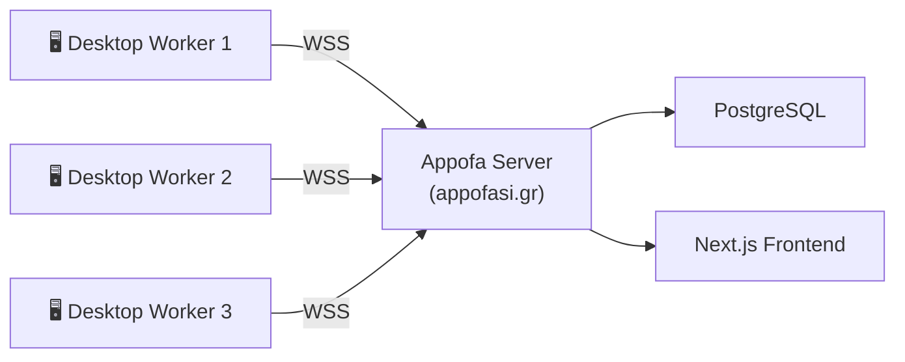

# Appofasistis — Local Greek Laws & Appofa Worker

## Greek law app on your PC

Appofasistis hosts the browser interface and a **local Neo4j Community graph database**.
Laws, articles, paragraphs, citations, source-text versions, notes, revision history, and
import jobs are stored in Neo4j on this PC. PDFs stay in the local `data/files/` directory.
The app works independently of Appofa. No cloud database is used.

Requires **Node.js 24+**, Windows, and the bundled local graph runtime. No Docker or system-wide
Java installation is required. `db:setup` downloads Neo4j Community 5.26.33 and Temurin Java 21
from their official publishers and verifies SHA-256 checksums before extraction.

1. Run `npm install` and `npm run db:setup` once, or double-click `install.bat`.
2. Double-click **`start-local.bat`**, or run `npm run local`.
3. Open **http://localhost:3001/**. A different `INTERNAL_API_PORT` in `.env` overrides this;
   the terminal prints the actual URL.

The launcher starts the graph database when needed, then starts the app. The HTTP app,
Neo4j HTTP endpoint (7474), and Bolt connection (7687) bind to loopback. A generated local
database password is stored in ignored `.runtime/credentials.json`, never sent to the browser.
The browser app is intended for the person using this PC and does not require a browser login.

### Graph and search

- Documents, article/paragraph units, sources, annotations, revisions, and jobs are graph nodes.
- `HAS_UNIT`, `CONTAINS`, `CITES`, `HAS_REFERENCE`, and `TARGETS` connect laws and provisions.
- Detected `AMENDS`, `REPEALS`, `REPLACES`, and `APPLIES` edges retain confidence and an
  **unreviewed** status. An inferred edge does not establish legal validity.
- Citation targets get stable placeholder identities until the corresponding law is imported.
- Multi-hop relationships can be inspected from the law's Connections tab.
- A Neo4j full-text index supports Greek text search, accent-insensitive queries, legal numbers,
  years, and personal annotations.
- Imports are transactional and idempotent. Refreshes preserve attached source text and notes.
- Source text versions and personal note revisions are kept separately. Conflicting note edits
  are rejected instead of silently overwriting another window's edits.

Parliament imports initially contain **metadata and descriptive text**, not extracted full legal text.
Paste source text with a URL to identify articles and paragraphs. PDFs can be saved locally
(up to 30 MB per file). OCR, automatic PDF text extraction, consolidated versions, and AI analysis
remain future work.

The local collection includes ten original Gazette publications, covering criminal law and
procedure, domestic violence, personal data, digital government, climate, consumer contracts,
and civil marriage. Topic filters, reading guides, article/paragraph selectors, and stable
provision links help explore them. Missing citation targets keep their identities; importing
the corresponding text later makes the available article and paragraph links navigable.
For source details and reproducible imports, see [the collection guide](docs/FOUNDATION_COLLECTION.md).

### Start from the historical sources

The first page now offers a timeline of selected origins: an 1821 local act, the
1822 national Constitution, and the first Gazette issue of 1833. Open `/#history`
to browse the historical category with **Παλαιότερα πρώτα** (oldest first).
The first Gazette contains Royal Decree No. 2; it is not labelled Law 1/1833.
The historical collection now has 219 records. Gazette issue 5 adds the army organisation decree (22 articles), the lancer regiment and transport company acts (two unnumbered bodies), with source-based links and explicit missing-appendix coverage. Gazette issue 6 adds two decrees with 18 articles and 15 original § sections, retaining the pay tables, oath and source discrepancies with exact links. Gazette issue 7 adds the infantry formation decision (nine original § sections) and a separate military amnesty (three numbered sections), with links to the army organisation decree. Gazette issue 8 supplies the promised appendix scans, 14 transcribed special pay provisions, the cockade decree, a clarification and a linked court erratum; the salary tables remain explicitly untranscribed. Gazette issue 9 adds seven articles on officers’ service claims, an unnumbered public-order proclamation and five verified citation links. Gazette issue 10 adds five original enforcement instructions and fourteen articles on public cleanliness, food and building offences, with an exact court-reference link. Gazette issue 11 adds three unnumbered decrees on battalion commanders and school and Church commissions, a clearly labelled consular-notice excerpt and a treaty reference resolved after Gazette 18. Gazette issue 12 adds the 20-article division and administration decree, five continuous appointment decisions, a clearly marked faded scan, and two exact article links; the printed 42-province claim and 47 listed entries are both preserved. Gazette issue 13 adds 33 transcribed articles across three ministry decrees, four exact links and a separate protocol-form scan; procedure article 16 remains explicitly untranscribed because its Greek source is faded. Gazette issue 14 adds eleven reviewed articles across four ministry decrees: complete Justice and Finance texts, explicit Interior and Church/Education excerpts, and a military-ministry reference resolved by Gazette 15. Gazette issue 15 adds forty units across six texts and a separate source scan, retaining saltworks paragraph gaps, a pending foreign decree and the conflicting printed publication dates. Gazette issue 16 adds seven complete Greek acts (thirteen units), eleven exact citation targets and the original scan; naval paragraphs and appointment lists keep their source scope, and the copper-exchange signature discrepancy is explicit. Gazette issue 17 now has 41 units: all 30 prefect articles (with 72 and 30 internal cases in articles 11–12), seven civil-service/oath articles, three salary articles and the complete ten-group appointment notice; eight available links and a pending numbered-decree target preserve exact source scope. Gazette issue 18 adds the complete twelve-article Greek–Bavarian treaty, separate publication and ratification texts, and resolves the earlier consular reference using its existing identity. Gazette issue 19 adds the full twelve-article Order of the Saviour decree and one-article returning-soldiers amnesty, with three active citation links and an explicitly absent design. Gazette issue 20 adds the full 27-article recruitment treaty, its separate notice and ratification, six uniform articles, twelve appointment articles, four corrections and three explicitly scan-only appendices (48 text units). Gazette issue 21 adds all 34 gendarmerie articles, four complete unnumbered decrees on flags, prosecutors’ assistants, Aegina court jurisdiction and amnesty extension, plus the original flag plate (38 text units, six active citations). Gazette issue 22 adds the full 43-article auxiliary-corps treaty, its publication notice and ratification, plus a separate scan of the pay table (45 text units, twelve active citations and one precise pending London-treaty provision). Gazette issue 23 adds the 25-article Church independence declaration, four complete meeting proceedings, Synod appointments, court decrees and consular/ministry notices (35 text units, eleven active and eighteen precise pending references); its German-only erratum remains a separate scan. Gazette issue 24 adds the complete 109-provision naval-directorate organisation decree with its original division headings, staffing, supply and treasury rules; the official twelve-page issue remains available separately, and absent forms are explicitly pending. Gazette issue 25 adds the seven-provision Turkish-coins decree, twelve primary paragraphs of the vineyard/raisins circular with eight direct paragraph links, eight appointment notices and the original four-page scan. Gazette issue 26 adds the Synod procedure decree (seven explicitly numbered Greek articles and its unnumbered closing clause), all ten lettered sections of the late-crops revenue circular, and the original scan, with sixteen available citation targets. Gazette issue 27 adds the Amfissa olive-grove circular and complete 21-article A/B leasing proclamation with selectable unnumbered closing rules, a labelled numerical-table excerpt, five personnel notices and the original scan (29 units, thirteen available citations). Gazette issue 28 adds the full twenty-article extraordinary-military-justice law, seven-section Tinos decision, four consular and two uniform provisions, complete grain circular and eight-page original scan (34 units, five available citations and one pending supporting-paper bundle). Gazette issue 29 begins with the complete seven-article printing/licensing decree and twenty-article press-police law plus the twelve-page original scan (27 articles and twelve working citation targets); its continuation adds the full 35-article press-abuse offences law with 24 available citations; the completed issue also includes seven roads and implementation instructions plus three full personnel notices (15 further units, one available route link and two pending decrees). Gazette issue 30 begins with seven copper-exchange provisions and a selectable cited preamble, the complete postal-contract publication notice and twelve-page original scan (nine units, two available prior-decree links and one pending postal contract). Its continuation adds the full 21-article Feraldi postal-ships contract, resolves the earlier publication link, and preserves three exact pending tariff/French-code scopes. The complete postal regulation now adds sixteen articles and selectable schedules with twelve fare rows, resolving the contract tariff reference while both French-code references remain pending. The letters-and-packets decree adds 24 articles with eight postal charges, five exact internal targets and a working Feraldi contract link; its separately dated declaration remains pending. Gazette 30 now has all eight Greek texts separately transcribed, including eleven mill-construction provisions, the Amfissa ownership-claims notice and the Attica olive-revenue auction notice; nine new internal targets resolve. Gazette 31 begins with the complete ten-region coin-exchange decree and five-clause Tinos court dissolution decision, resolving five citation scopes to previously collected texts while the two cited court reports remain pending. All remaining Gazette 31 texts now add eleven records and 57 units, including military corps organization, public-property forms, Sicily shipping rules and the linked final correction notice. Gazette 32 adds the entire 63-paragraph Court of Audit founding decree, selectable source titles, the first-appointments notice and the eight-page scan, with four exact internal paragraph targets. All twelve Gazette 33 Greek texts now add customs, garden/mill/olive leasing, Munich school places, engineer uniforms and six appointment notices, preserving eight native garden paragraphs and their four exact links. The 1822 Constitution has its first
40 reviewed paragraphs (α΄–μ΄ of 110), retaining the original numbering and
shareable paragraph links. The decree has seven reviewed article transcriptions.
The second Gazette includes four decrees with 35 reviewed articles, an unnumbered
territorial declaration, and an explicitly linked circular excerpt. The monetary
regulation preserves the printed Greek figures and flags differences between columns. The third Gazette adds an 1824 criminal excerpt (seven provisions), national
property Decree 948 and its linked notice, plus a valuation order and finance
circular excerpt. The fourth Gazette adds five fully transcribed acts with 40 articles, including
explicit links between the licensing, public-security and court provisions.
Archival scans and excerpts are labelled with their actual coverage. See the
[historical source guide](docs/HISTORICAL_ORIGINS.md) for provenance and repeatable imports.

### Gazette index and annual progress

Open **Ευρετήριο ΦΕΚ** in the sidebar or the homepage's **Ευρετήριο & πρόοδος**
card (`/#gazettes`). Browse by year, Gazette series, act category, issue number,
and PDF status. Each year shows saved versus existing issues, missing numbers,
the next official PDF, and links to imported texts. A guide explains law,
Gazette, and provision numbering. Saved scans and transcribed text are counted
separately. Official inventory snapshots currently cover eight years; unknown
totals and the current year's changing inventory are labelled explicitly.
See [the Gazette index guide](docs/GAZETTE_INDEX.md) for counting rules and sources.

### Data, export, and restore

- `data/neo4j/`: database files and transaction logs; do not edit these by hand.
- `data/files/`: downloaded PDFs.
- `data/backups/`: consistent graph exports from the app's **Τοπικά δεδομένα** page.
- `.runtime/`: the portable Neo4j and Java runtimes and local database credentials.

The export is a versioned JSON graph containing nodes, relationships, source-text snapshots,
annotations, revision history, and import jobs. Save the `files/` directory alongside the export
for a complete copy of the downloaded PDFs. To restore an export into an **empty** law collection:

```powershell
npm run db:restore -- C:/path/to/greek-laws-backup.json
```

To use another already-running **local** Neo4j instance, configure `NEO4J_URI`, `NEO4J_USER`,
`NEO4J_PASSWORD`, and optionally `NEO4J_DATABASE`. Remote database addresses are rejected.
The portable runtime uses this checkout's `data/` folder. `LEGAL_DATA_DIR` can override where
app-managed PDFs and exports are stored; it does not move the Neo4j database files.

`npm run local` disables Appofa communication regardless of `.env`. Regular `npm start` can
also accept Appofa tasks when worker credentials are configured. Set `WORKER_ENABLED=false`
to disable that connection, or `WORKER_ENABLED=true` to require its credentials.

### Verification

`npm test` runs unit tests. With a local graph server running, run the real database checks:

```powershell
$env:NEO4J_TESTS='true'
npm test
```

Graph tests use unique disposable test collections and remove only their own test nodes.

---

**Desktop worker node for [Appofa](https://github.com/Antoniskp/Appofa) — offloads server tasks to volunteer PCs**


[](https://github.com/Antoniskp/Appofasistis/actions/workflows/ci.yml)

---

## What is this?

Appofasistis is a standalone Node.js application that runs on your desktop and helps the [Appofa](https://appofasi.gr) platform by volunteering your computer's resources to handle tasks that would otherwise burden the server.

It connects to the Appofa server via WebSocket, receives work (like link previews, poll stats, leaderboard calculations), processes it locally, and sends results back — reducing the need for expensive server infrastructure.

## Architecture



## Download

### Option 1 — Download ZIP (no Git required)

1. Go to the [GitHub repository](https://github.com/Antoniskp/Appofasistis).
2. Click the green **"<> Code"** button → **"Download ZIP"**.
3. Extract the ZIP to a folder of your choice.

### Option 2 — Clone with Git

```bash
git clone https://github.com/Antoniskp/Appofasistis.git
```

> **Note:** Both options give you the same files. Use whichever you're more comfortable with.

## Quick Start

```bash
cd Appofasistis        # navigate to the cloned repo or extracted ZIP folder
npm install
cp .env.example .env   # edit with your server URL + worker token
npm start
```

## Windows Easy Install

No command line needed — just double-click!

1. **Double-click `install.bat`** — checks Node.js, installs dependencies, and creates `.env` for you.
2. **Edit `.env`** with Notepad — fill in your `SERVER_URL` and `WORKER_TOKEN` (get the token from the Appofa admin panel).
3. **Double-click `start.bat`** — launches the worker. A window will open showing live log output.

> **First time?** You'll need [Node.js 24+](https://nodejs.org) installed. `install.bat` will tell you if it's missing.

## Configuration

Copy `.env.example` to `.env` and set the following variables:

| Variable | Required | Default | Description |
|---|---|---|---|
| `SERVER_URL` | ✅ | — | WebSocket URL of the Appofa server (e.g. `wss://appofasi.gr/ws/workers`) |
| `WORKER_TOKEN` | ✅ | — | Authentication token obtained from the Appofa admin panel |
| `WORKER_ID` | | Hostname (or generated UUID fallback) | Unique worker identity sent to the backend in auth headers and outbound messages |
| `INTERNAL_API_PORT` | | `3001` | Local HTTP port for `GET /health` and `POST /internal/snapshots` |
| `WORKER_NAME` | | `unnamed-worker` | Human-readable name shown in the admin dashboard |
| `MAX_CONCURRENT_TASKS` | | `3` | How many tasks to process simultaneously |
| `HEARTBEAT_INTERVAL` | | `10000` | How often (ms) to send a heartbeat to the server |
| `RECONNECT_DELAY` | | `5000` | Base delay (ms) before reconnecting after a disconnect |
| `LOG_LEVEL` | | `info` | Log verbosity: `debug` \| `info` \| `warn` \| `error` |

## File Structure

```
├── package.json
├── .env.example
├── .gitignore
├── README.md
├── LICENSE
├── install.bat               # Windows one-click setup
├── start.bat                 # Windows one-click start
├── .github/
│   └── workflows/
│       └── ci.yml            # GitHub Actions CI (Node 18/20/22)
├── src/
│   ├── index.js              # Entry point — bootstraps everything
│   ├── connection.js         # WebSocket connection, reconnect, exponential backoff
│   ├── heartbeat.js          # Periodic CPU/memory reporting to server
│   ├── taskRunner.js         # Receives tasks, routes to handlers, sends results
│   ├── logger.js             # Timestamped logger with emoji prefixes
│   ├── config.js             # Loads .env, validates required config
│   ├── internalApi.js        # Local HTTP endpoints for health + protected snapshots ingest
│   ├── adapters/
│   │   └── parliamentBills.js  # Fetch + parse Hellenic Parliament HTML → normalised items
│   ├── jobs/
│   │   └── runParliamentBills.js  # CLI scraper job — saves output/parliament-bills.json
│   └── tasks/
│       ├── index.js          # Task registry — maps task type strings to handlers
│       ├── linkPreview.js    # Fetches URL, parses OpenGraph meta tags
│       ├── pollStats.js      # Aggregates votes into counts and percentages
│       ├── leaderboard.js    # Sorts and ranks scores, returns top N
│       └── textAnalysis.js   # Word count, reading time, keyword extraction
├── output/
│   └── parliament-bills.json  # Generated locally by scrape:parliament (not in Git)
└── test/
    ├── config.test.js
    ├── connection.test.js
    ├── linkPreview.test.js
    ├── internalApi.test.js
    ├── parliamentBills.test.js
    ├── pollStats.test.js
    ├── leaderboard.test.js
    └── textAnalysis.test.js
```

## Internal API (Appofa integration MVP)

### `GET /health`

Returns:

```json
{ "ok": true, "service": "appofasistis", "time": "2026-05-12T20:00:00.000Z" }
```

### `POST /internal/snapshots`

- Required header: `x-worker-token: <WORKER_TOKEN>`
- Body must be a JSON object.

Success response:

```json
{ "ok": true, "receivedAt": "2026-05-12T20:00:00.000Z" }
```

Example:

```bash
curl -X POST http://localhost:3001/internal/snapshots \
  -H "content-type: application/json" \
  -H "x-worker-token: $WORKER_TOKEN" \
  -d '{"source":"appofa","items":[]}'
```

## Supported Task Types

### `linkPreview`
Fetches a URL and extracts OpenGraph/meta preview data.

**Payload:** `{ url: string }`

**Result:** `{ url, title, description, image, siteName }`

---

### `pollStats`
Aggregates an array of votes into counts and percentages.

**Payload:** `{ votes: number[], options?: string[] }`

**Result:** `{ total: number, results: [{ option, votes, percentage }] }`

---

### `leaderboard`
Sorts and ranks an array of score entries, returning the top N.

**Payload:** `{ scores: [{ id, name, score }], topN?: number }`

**Result:** `{ ranked: [{ rank, id, name, score }] }`

---

### `textAnalysis`
Analyses text for word count, reading time, and top keywords.

**Payload:** `{ text: string, topKeywords?: number }`

**Result:** `{ wordCount, readingTimeMinutes, keywords: [{ word, count }] }`

---

### `greekLegalCitations`
Extracts Greek legal citations from text and normalises them into stable graph IDs.

**Payload:** `{ text: string, knownDocuments?: object[] }`

**Result:** `{ citations: [{ raw_text, document_type, document_canonical_id, target_canonical_id, article, paragraph, relation_type, resolved }], stats }`

---

### `normalizeGreekLaw`
Splits Greek legal text into articles/paragraphs and extracts outgoing legal references from each unit.

**Payload:** `{ document?: object, text: string, knownDocuments?: object[] }`

**Result:** `{ document, units, references, stats }`

---

### `importParliamentLaws`
Fetches one page from the Hellenic Parliament Open Data `q=laws` API and maps each record to the legal graph format.

**Payload:** `{ pageNo?: number, pageSize?: number, lawNum?: number|string, title?: string, type?: string, includeRaw?: boolean, knownDocuments?: object[] }`

**Result:** `{ source_name, source_url, imported_at, page, documents, stats }`

## WebSocket Protocol

All messages are JSON objects. The worker:

0. **Authenticates the connection** with:
   - Query token (backward compatibility): `?token=<WORKER_TOKEN>`
   - Headers: `x-worker-id: <WORKER_ID>`, `x-worker-token: <WORKER_TOKEN>`
   - Outbound send failures are retried with exponential backoff and structured logs (without logging secrets)

1. **Registers** on connection open:
   ```json
   { "type": "register", "workerId": "worker-athens-01", "name": "my-desktop", "capabilities": ["linkPreview", "pollStats", "leaderboard", "textAnalysis", "greekLegalCitations", "importParliamentLaws", "normalizeGreekLaw"], "maxConcurrentTasks": 3 }
   ```

2. **Receives tasks** from the server:
   ```json
   { "type": "task", "taskId": "abc123", "taskType": "linkPreview", "payload": { "url": "https://example.com" } }
   ```

3. **Sends results** back:
   ```json
   { "type": "taskResult", "workerId": "worker-athens-01", "taskId": "abc123", "status": "success", "result": { ... } }
   ```

4. **Sends heartbeats** periodically:
   ```json
   { "type": "heartbeat", "workerId": "worker-athens-01", "load": 0.5, "memory": { "used": 512, "total": 8192, "usedMB": 512, "totalMB": 8192 }, "activeTasks": 1 }
   ```

## Multi-worker deployment notes

- Give each worker a unique `WORKER_ID` (for example: `worker-athens-01`, `worker-athens-02`).
- Set `WORKER_ID` explicitly in production so identity stays stable across restarts.
- Reuse or rotate `WORKER_TOKEN` based on your backend policy; both `x-worker-token` and the legacy query token are sent for compatibility.
- Keep `WORKER_NAME` human-friendly for dashboards and `WORKER_ID` stable for backend identity/debugging.

Example `.env` snippets:

```bash
# Worker A
WORKER_ID=worker-athens-01
WORKER_NAME=athens-desktop-01

# Worker B
WORKER_ID=worker-athens-02
WORKER_NAME=athens-desktop-02
```

## Development

```bash
npm run dev   # starts with Node.js built-in watch (Node 18+)
```

## Running Tests

```bash
npm test
```

Tests cover all built-in task handlers using the Node.js built-in test runner — no extra dependencies needed.

## Known Limitations & Future Work

The following gaps exist because the Appofa backend WebSocket server is not yet publicly available:

| Gap | Notes |
|---|---|
| **`SERVER_URL` / `WORKER_TOKEN` required at startup** | You must provide real values before the worker can connect. Until the Appofa admin panel issues tokens, you cannot connect to a live server. |
| **No mock/local server bundled** | The worker will keep reconnecting (with exponential back-off) until the server comes online — this is intentional and safe. |
| **Worker registration not yet persisted server-side** | The server registration flow is implemented on the worker side; the Appofa backend side is a future deliverable. |
| **`os.loadavg()` always returns `[0,0,0]` on Windows** | Node.js does not support `loadavg` on Windows. The heartbeat will report `load: 0` on Windows machines, which is harmless. |

## License

Copyright (c) 2026 Antoniskp. All Rights Reserved.

---

## Parliament Bills Scraper

A standalone scraper for the [Hellenic Parliament legislative work pages](https://www.hellenicparliament.gr/Nomothetiko-Ergo).
It runs **entirely on your PC** — no server connection or token required.

## Hellenic Parliament Legal Graph Importer

The worker can also import completed law/bill metadata from the official Hellenic Parliament Open Data API:

```text
https://www.hellenicparliament.gr/api.ashx?q=laws
```

Use the WebSocket task type `importParliamentLaws` to fetch small batches:

```json
{
  "type": "task",
  "taskId": "import-laws-page-1",
  "taskType": "importParliamentLaws",
  "payload": {
    "pageNo": 1,
    "pageSize": 25
  }
}
```

The result maps each Parliament record into:

- `document`: normalized legal metadata, including stable IDs such as `law:5329:2026`
- `units`: a body/article/paragraph structure when text is available
- `references`: outgoing links to laws, articles, paragraphs, presidential decrees, and FEK records
- `attachments`: source PDFs from Parliament fields such as `LawPhotocopy`, `VotedLaws`, reports, and amendments
- `stats`: document/reference/attachment counts

This importer is intentionally page-based. Appofa should create persistent import jobs and request pages gradually, so large imports can resume safely and avoid overwhelming official public services.

### How to run

```bash
npm install
npm run scrape:parliament
```

Output is saved to `output/parliament-bills.json`.

### What the scraper does

1. Loads a fixed list of known Hellenic Parliament section URLs (submitted bills and passed bills).
2. Fetches each section page over HTTPS and parses the static HTML.
3. Extracts bill rows from parliament-style `<table>` elements.
4. For each extracted bill, fetches its detail page (`source_url` with `law_id` filter) to obtain the full (non-truncated) official title and any available summary.
5. Derives a stable `external_id` of the form `hp-bill-<law_id>` from the URL, falling back to a title slug if no `law_id` is present.
6. Infers a conservative English `category` code from the ministry/topic text when a confident match exists.
7. Normalises each item to the output schema and writes `output/parliament-bills.json`.

> **Why fixed URLs?**  The landing page (`/Nomothetiko-Ergo`) renders its navigation menu via JavaScript.  A server-side HTML parser cannot discover the section links dynamically, so they are hard-coded in `KNOWN_SECTIONS` inside `src/adapters/parliamentBills.js`.  If a section URL changes, update that constant.

### Output schema

```json
{
  "source_name": "hellenic-parliament-bills",
  "source_type": "bill",
  "scraped_at": "2026-05-06T12:00:00.000Z",
  "items": [
    {
      "external_id": "hp-bill-<law_id UUID>",
      "title_official": "Full official title (fetched from detail page when possible)",
      "summary_official": "Official description if found on detail page, otherwise null",
      "status": "submitted | in_committee | passed | completed | consultation | scheduled | unknown",
      "status_label_el": "Κατατεθέντα (Σχέδιο νόμου)",
      "category": "health | energy | economy | education | agriculture | justice | foreign_affairs | interior | labour | infrastructure | defence | tourism | digital | social | null",
      "published_at": "YYYY-MM-DD",
      "meeting_date": null,
      "vote_date": null,
      "source_url": "https://www.hellenicparliament.gr/...?law_id=...",
      "raw_text": "..."
    }
  ]
}
```

### File structure

```
src/
  adapters/
    parliamentBills.js   # fetch + parse Hellenic Parliament HTML → normalised items
  jobs/
    runParliamentBills.js # CLI entry point — runs scraper and writes JSON file
output/
  parliament-bills.json  # generated locally (not committed to Git)
```

### Manual testing steps

1. Run `npm run scrape:parliament` — the terminal should show:
   - `Using 2 known section URL(s) to crawl`
   - Per-section item counts (e.g. `Extracted 25 item(s) from "Κατατεθέντα (Σχέδιο νόμου)"`)
   - `Total unique items: N` where N > 0
   - `Enriching N item(s) via detail pages…` followed by per-item `→ Detail` log lines
   - `Detail enrichment complete.`
2. Open `output/parliament-bills.json` and verify:
   - `external_id` values start with `hp-bill-` followed by a UUID
   - Bill titles are full (not truncated with `...`)
   - `category` is an English code (e.g. `health`, `energy`, `economy`) where the ministry is recognisable, and `null` otherwise
   - `source_url` values are valid Hellenic Parliament URLs containing `law_id=`
3. If the Parliament website changes its URL structure, update `KNOWN_SECTIONS` in `src/adapters/parliamentBills.js`.
4. Run `npm test` to verify all unit tests pass.

### Notes

- The scraper uses only Node.js built-in modules (`https`, `fs`) and the already-bundled `node-html-parser` — no extra dependencies needed.
- Output is de-duplicated by `external_id` (stable `hp-bill-<law_id>` when available).
- `external_id` uses the UUID from the `law_id` URL parameter for stability; it falls back to a title slug only when no `law_id` is present.
- `category` is inferred conservatively from the ministry/topic text. Supported codes: `health`, `energy`, `economy`, `education`, `agriculture`, `justice`, `foreign_affairs`, `interior`, `labour`, `infrastructure`, `defence`, `tourism`, `digital`, `social`. Unrecognised text leaves `category` as `null`.
- Detail-page fetches add a 200 ms pause between requests to avoid overwhelming the Parliament server.
- Fields that cannot be reliably extracted are left as `null` (e.g. `meeting_date`, `vote_date`).
- AI analysis of items is a separate step handled by the Appofa server and is **not** included here.

Recent 2026 legislation now has a separate validated import workflow: `python scripts/extract-recent-laws.py`, `python scripts/extract-incorporated-code.py`, then `node scripts/import-recent-laws.js`. The January–November batches contain ninety-five laws (5265–5359) with 5,230 indexed articles and 10,766 native numbered paragraphs. Use `--only=5357,5358,5359` after the input directory to import an explicit new batch. The reviewed range has no missing law numbers; the planning Code in 5306 now includes separately linked articles 1–200 and 1,102 numbered paragraphs, while articles 201–477, incorporated contracts and financial tables remain PDF-only where stated in the reader. See [2026 source and verification notes](docs/RECENT_LAWS_2026.md).

The November–December 2025 collection covers laws 5253–5264 with 729 indexed articles. Download the original Gazette PDFs from the links below into `output/laws-2025/`, using the filenames `law-5253-2025.pdf` through `law-5264-2025.pdf`. The extractor and importer check their SHA-256 hashes against the manifest.

| Law | Indexed coverage | Official Gazette |
| --- | --- | --- |
| 5253/2025 | All 43 articles on public broadcaster ERT and media freedom. | [A 212, 25 November 2025](https://api.et.gr/apiLAW/1/2025/5253/pdf) |
| 5254/2025 | All three law articles on the Patras hospital donation. The agreement and its appendix are in the PDF. | [A 218, 28 November 2025](https://api.et.gr/apiLAW/1/2025/5254/pdf) |
| 5255/2025 | All 64 articles on market oversight, consumer protection, and related measures. | [A 219, 28 November 2025](https://api.et.gr/apiLAW/1/2025/5255/pdf) |
| 5256/2025 | All 49 articles on digital road safety and related measures. | [A 223, 8 December 2025](https://api.et.gr/apiLAW/1/2025/5256/pdf) |
| 5257/2025 | All three approval law articles. The published portion of the draft agreement is in the PDF. | [A 224, 8 December 2025](https://api.et.gr/apiLAW/1/2025/5257/pdf) |
| 5258/2025 | All 21 articles on port and ship safety oversight and related measures. | [A 227, 9 December 2025](https://api.et.gr/apiLAW/1/2025/5258/pdf) |
| 5259/2025 | All 268 articles on public-benefit assets and related measures, including the six tables in article 197. | [A 228, 12 December 2025](https://api.et.gr/apiLAW/1/2025/5259/pdf) |
| 5260/2025 | All 16 law articles on transport concessions. The four incorporated texts are in the PDF. | [A 229, 12 December 2025](https://api.et.gr/apiLAW/1/2025/5260/pdf) |
| 5261/2025 | All 81 articles on carbon capture, use, transport and storage and related measures. Annexes I–VI are in the PDF. | [A 231, 12 December 2025](https://api.et.gr/apiLAW/1/2025/5261/pdf) |
| 5262/2025 | Both state budget articles. Budget tables are in the PDF. | [A 235, 17 December 2025](https://api.et.gr/apiLAW/1/2025/5262/pdf) |
| 5263/2025 | All 45 articles, including the AI Factory charter in article 8. | [A 238, 19 December 2025](https://api.et.gr/apiLAW/1/2025/5263/pdf) |
| 5264/2025 | All 134 articles. The article 128 tables and maps are in the PDF. | [A 239, 19 December 2025](https://api.et.gr/apiLAW/1/2025/5264/pdf) |

```powershell
python scripts/extract-recent-laws.py --year=2025
node scripts/import-recent-laws.js --year=2025
```
